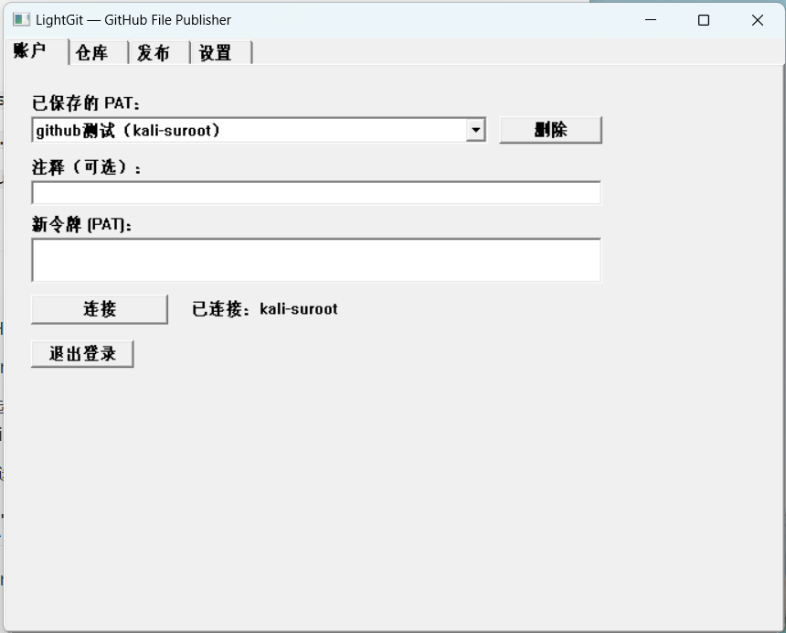
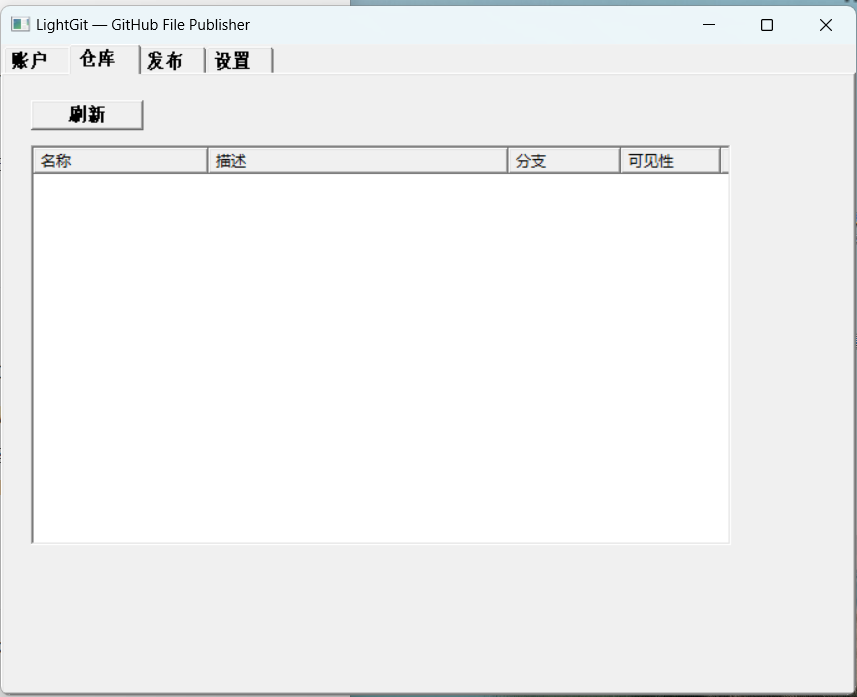
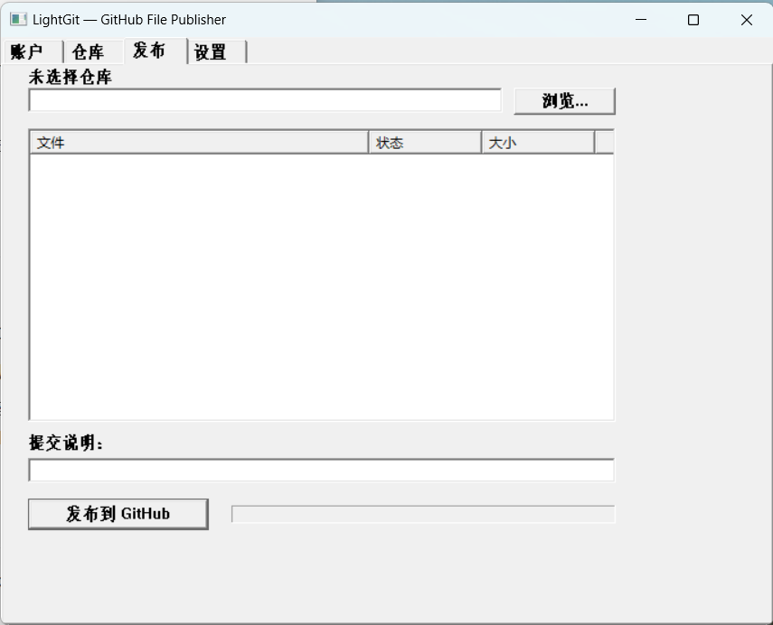
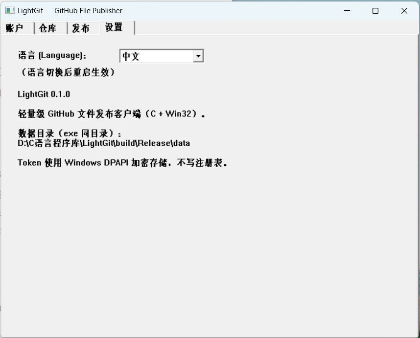

# LightGit

一个轻量、简单、专注于文件发布的 GitHub Windows 客户端。

- 选择文件夹：关联本地项目
- 选择文件：只发布需要的内容
- 填写说明：简单的一行文字
- 一键发布：自动完成 Commit + Push

## 本项目由LightGit自举发布并提交

选 LightGit/ 作为本地目录后，LightGit 会读根目录的 .gitignore，自动排除：

- build/（编译产物 + 里面的 data/pat_vault.json 加密凭证库）
 - data/（运行时数据）
- *.exe / *.obj / *.pdb / *.lib 等


## 技术栈

- 核心逻辑：C 语言
- GUI：纯 Win32 API（Unicode）
- 构建：CMake + Visual Studio 2022 (MSVC) + Windows SDK
- Git 引擎：自行实现（Blob / Tree / Commit / Packfile / Smart HTTP Push）
- 不依赖 Git CLI / libgit2 / libcurl

## 依赖说明

唯一第三方依赖为 [miniz](https://github.com/richgel999/miniz)（zlib 兼容的DEFLATE 压缩实现，用于生成合法 Git packfile），已本地置入 `external/miniz/`并静态链接进 EXE。Windows 未提供原生 zlib 兼容压缩 API，故需引入，详见
`external/miniz/LICENSE`。

其余功能均使用 Windows 原生 API：

| 功能 | 实现 |
|---|---|
| SHA-1 | BCrypt |
| HTTPS | WinHTTP |
| Token 加密 | DPAPI（CryptProtectData） |
| 文件扫描 | FindFirstFileW / FindNextFileW |
| 文件变化通知 | （v1 未启用，手动 Refresh） |
| 文件夹拖放 | DragAcceptFiles / WM_DROPFILES |
| JSON | 自行实现的轻量解析器 |

## 如何编译（Visual Studio 2022）

### 前置要求

安装 Visual Studio 2022，勾选「使用 C++ 的桌面开发」工作负载（包含 MSVC 编译器、Windows 10/11 SDK 与 CMake 工具）。

### 编译步骤

1. 打开 Visual Studio 2022。
2. 菜单「文件」→「打开」→「本地文件夹…」，选择本项目根目录（即包含 `CMakeLists.txt` 的目录）。VS 会自动识别为 CMake 项目。
3. 顶部配置下拉框选择 **x64-Release**（首次打开需等待 CMake 自动生成，稍候）。
4. 菜单「生成」→「全部生成」（或快捷键 `Ctrl+Shift+B`）。

### 产物（相对路径）
- `build\Release\LightGit.exe`（主程序，静态 CRT，仅依赖 Windows 系统 DLL）
- `build\Release\LightGitTests.exe`（单元测试）
- `build\Release\LightGitPush.exe`（命令行发布工具，集成测试用）
- `build\Release\LightGitGithub.exe`（GitHub API 验证工具）

## 如何运行

1.复制这个文件：

```
D:\C语言程序库\LightGit\build\Release\LightGit.exe
```

粘贴到任意目录（桌面、U 盘、别的电脑都行）。

双击运行。它是自包含的（只依赖 Windows 系统 DLL），会在自己旁边自动建 data\ 目录。

 ⚠️ 注意：data\credentials\pat_vault.json 里的 token 是 DPAPI 加密的，只在本机当前用户能解。换电脑 / 换 Windows 用户后
 需要重新登录一次。

双击 `LightGit.exe`。

2.**Account**（账户） 页：粘贴 GitHub Personal Access Token，点 Connect。



3.**Repository**（仓库） 页：点 Refresh 列出仓库，**左键/右键**点击**仓库名**选中目标仓库。



4.**Publish** （发布）页：Browse 选择本地目录（或直接拖放文件夹到窗口），勾选要发布的文件，填写 Commit Mess，点击 Publish to GitHub。


5.**Settings**（设置）页：language选择语言。



## 如何创建 GitHub PAT

1. GitHub → Settings → Developer settings → Personal access tokens。
2. 建议使用 **Fine-grained token**，权限：
   - Contents: Read and write
   - Metadata: Read-only
3. 仓库权限尽量限定在实际需要的仓库。

## 数据存储（不写注册表）

所有数据保存在 **exe 同目录 `data/`**：

```
data/
├── config.json           # 用户名、默认分支、项目列表
├── credentials/token.bin # DPAPI 加密的 PAT
└── manifest.txt          # 上次发布状态（用于变化检测）
```

## 当前不支持（Git 功能边界）

- 不实现 Clone / Pull / Merge / Rebase / Tag / Git LFS / submodule 解析。
- 本地删除文件不会同步删除远程文件（发布时忽略本地删除）。
- **单文件 > 100 MiB 会阻止上传（GitHub 硬限制）**；50~100 MiB 显示警告。
- 超大远程仓库（tree 被 GitHub 截断）暂不支持。
- 第一版只做 SHA-1 仓库、完整对象 packfile（无 delta 压缩）。

## 单元测试

```bat
cd build\Release
LightGitTests.exe
```

覆盖：SHA-1、Blob、Tree、Commit、Packfile、JSON、.gitignore、Manifest、文件扫描。
Packfile 的官方 Git 兼容性可用 `git unpack-objects` / `git fsck --strict` 验证。

## 目录结构

见 `docs/ARCHITECTURE.md`。
